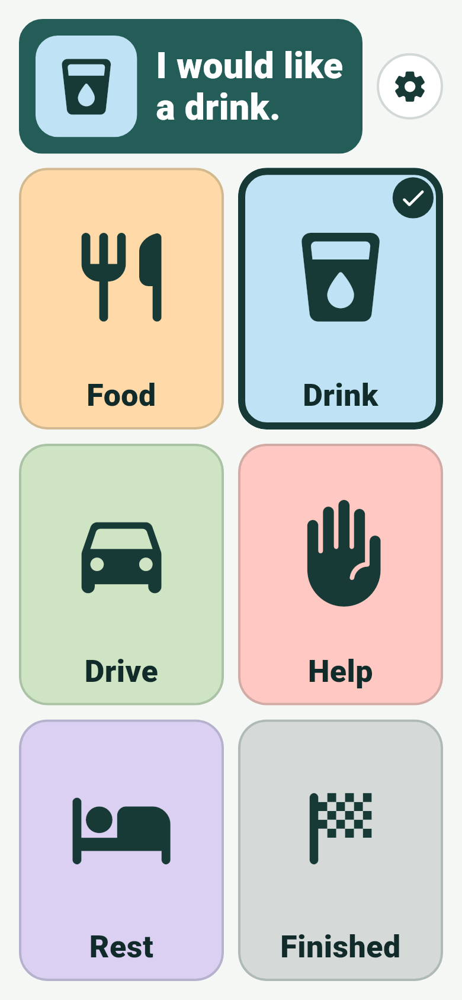
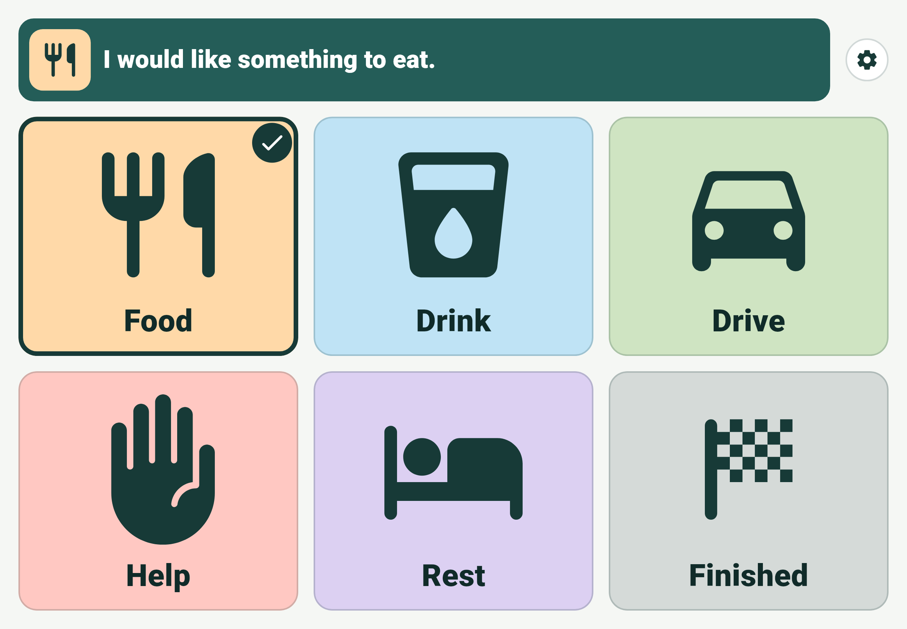

<p align="center">
  
</p>

<p align="center">
  <a href="https://github.com/quangshuynh/carebridge/actions/workflows/ci.yml">
    
  </a>
  <a href="https://github.com/quangshuynh/carebridge/actions/workflows/docs.yml">
    
  </a>
  <a href="https://flutter.dev/">
    
  </a>
  <a href="LICENSE">
    
  </a>
</p>

# CareBridge

CareBridge is an early-stage, local-first communication app. It helps nonverbal people express familiar everyday wants, needs, and routines to caregivers through large visual choices and spoken phrases.

<p align="center">
  
  &nbsp;
  
</p>

## What it does

- Shows six large sample choices: Food, Drink, Drive, Help, Rest, and Finished.
- One tap marks the choice, shows its picture and phrase, speaks the phrase with the device's text-to-speech, and gives a light haptic tap.
- Keeps every choice visible and in place on phones and tablets, in portrait and landscape.
- Offers a high-contrast display, saved on the device, behind a deliberate one-second hold so it cannot be opened by accident.
- Lets caregivers add choices and change their words, spoken phrases, pictures, colors, order, and visibility from settings, or restore the original six.
- Lets caregivers export settings and choices to a local file and import them on another device, with a confirmation before anything is replaced.
- Works offline with no account. CareBridge has no cloud service, analytics, or advertising.

The six original choices are a starting point. Custom choices use built-in pictures; personal photos are not supported yet.

CareBridge is not a medical device, diagnostic tool, or treatment, and it does not replace professional AAC assessment. A selection communicates only its configured phrase.

## Status and platforms

CareBridge is a foundation for real-world usability testing, not production use. It targets **Android, iOS, and iPadOS**. CI builds all three, but physical-device testing is still outstanding.

## Quick start

With the stable [Flutter SDK](https://docs.flutter.dev/get-started/install) installed:

```sh
flutter pub get
flutter run
flutter test
```

iPhone and iPad builds require macOS with Xcode. See [Getting started](https://quangshuynh.github.io/carebridge/getting-started/) for device setup.

## Documentation

The full documentation is at **[quangshuynh.github.io/carebridge](https://quangshuynh.github.io/carebridge/)**:

- [Communicator board](https://quangshuynh.github.io/carebridge/communicator-board/): exact interaction behavior
- [Customizing choices](https://quangshuynh.github.io/carebridge/customizing-choices/): the caregiver editor
- [Accessibility](https://quangshuynh.github.io/carebridge/accessibility/) and [Privacy](https://quangshuynh.github.io/carebridge/privacy/)
- [Backup and restore](https://quangshuynh.github.io/carebridge/backup/): what a backup contains and its file format
- [Architecture](https://quangshuynh.github.io/carebridge/architecture/)
- [Device validation](https://quangshuynh.github.io/carebridge/device-validation/) checklist

The source for these pages is in [`docs/`](docs/).

## Contributing

Issues and focused pull requests are welcome. See [CONTRIBUTING.md](CONTRIBUTING.md).

## License

CareBridge is licensed under the [Apache License 2.0](LICENSE).
