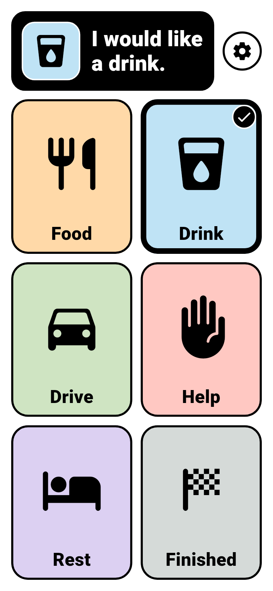

# Accessibility

Accessibility is part of CareBridge's architecture, not a later layer. This page describes the decisions in the current build and what still needs testing.

!!! warning "Needs differ between people"
    Communicators differ in vision, hearing, motor control, attention, and how they relate to pictures and speech. A design that works well for one person may not suit another. The decisions below have been checked in automated tests, not with communicators, and they are a starting point rather than a finished answer.

## Large, stable targets

- Every choice is visible without scrolling on phones and tablets in both orientations. Choices are sized to fill the available space.
- The whole visible area of a choice responds to a tap.
- Targets do not move under a finger. The board does not scroll when it fits, and confirmation has a fixed size that never depends on the phrase.
- In an unusually small window, choices keep a minimum of 110 logical pixels and the grid scrolls instead of shrinking them further.
- Selection needs only a single tap. There are no swipes, long presses, hover states, or other gesture-only actions.

## Selection without relying on color

A selected choice is shown in several ways at once:

- a much thicker dark border,
- a check badge in the corner,
- the choice's picture and phrase in the confirmation area, which also changes from white to dark teal.

Color is never the only signal.

## Pictures and words together

Each choice shows an icon and a text label. The confirmation shows the picture beside the full phrase, and the phrase is also spoken. Nobody has to read to use the board, and nobody has to recognize the icon alone.

The current icons are standard Material icons used as placeholders. They have not been validated with any communicator.

## Contrast

Labels and icons use a near-black ink on light pastel backgrounds, a contrast ratio of at least 10:1 for every sample choice. The selected confirmation uses white text on dark teal, about 7.5:1. Both exceed the WCAG AAA threshold of 7:1 for normal text. These ratios are calculated from the colors in the source code, and a test fails if they drop. Screen brightness, glare, and a person's vision still affect what is visible in practice.

### High contrast

<figure markdown>
{ width="260" }
</figure>

High contrast makes text, icons, and every border pure black, thickens the borders (3 pixels unselected, 8 selected), and shows the selected confirmation as white on black. Each choice keeps its own background color so choices stay easy to tell apart, and selection still shows as a heavier border plus a check badge, not by color alone. Black text and icons are at least 14:1 against every sample choice color.

High contrast turns on in either of two ways:

- **The CareBridge setting.** Hold the round settings button beside the confirmation area for one second, then turn on **High contrast**. The setting is saved on the device and applies again after the app restarts.
- **The device.** When the system asks apps for more contrast, CareBridge uses high contrast regardless of its own setting. Flutter reports this request from iOS and iPadOS (**Increase Contrast**) and from Android 14 and later. On older Android versions, use the CareBridge setting.

Changing contrast takes effect at once, with no fade, and never changes the choices, phrases, speech, or current selection.

## Focus

When a keyboard or switch moves focus to a choice, a thick ring appears inside its border. The ring is a different shape from the selected border and check, so focus and selection are never confused. Touch does not show the ring.

## Text scaling

Labels and phrases follow the system text size. When the scaled text would not fit its space, it shrinks to the largest size that fits without splitting words. Text is cut off only if it cannot fit even at the minimum size.

Widget tests check that every choice stays visible at 1x, 2x, and 3x text scale on phone and tablet sizes in both orientations, and that longer realistic labels and phrases stay whole at 2x.

## Screen readers

- Each choice is announced as an enabled button with its label, a hint of the form "Says: I would like a drink.", and its selected state.
- The check badge is hidden from screen readers because the selected state already conveys it.
- The confirmation is a live region once something is selected. It announces "Selected." followed by the phrase. Before any selection it reads "Choose what you want to say".
- The settings button is announced as "Settings" with a long-press action only. Screen-reader users open it with the reader's own long-press gesture (double-tap and hold).
- The High contrast switch announces its name and on or off state. The state is also written beside it as "On" or "Off".

With TalkBack or VoiceOver on, the screen reader's announcement and CareBridge's own speech may overlap. How this sounds on real devices has not been checked yet.

## Motion

Selection appears instantly with no easing. The only animation is a 150 millisecond color change on the confirmation area, which is removed entirely when the system asks apps to reduce or disable animations. This is the same in high contrast.

## Orientation and screen size

- Phones and tablets are supported in portrait and landscape.
- Devices whose shortest side is at least 600 logical pixels get tablet spacing and margins.
- On very wide screens the board is limited to 1200 logical pixels wide and centered, so choices stay within reach.
- The board respects safe areas such as notches, rounded corners, and system bars.

See [Communicator board](communicator-board.md#layout) for how confirmation moves beside the choices on short landscape screens.

## Still to verify on devices

Automated tests cannot confirm how CareBridge feels in use. The [device validation checklist](device-validation.md) covers what remains, including screen-reader announcements, large accessibility text settings, speech audibility, haptics, and accidental exits.
